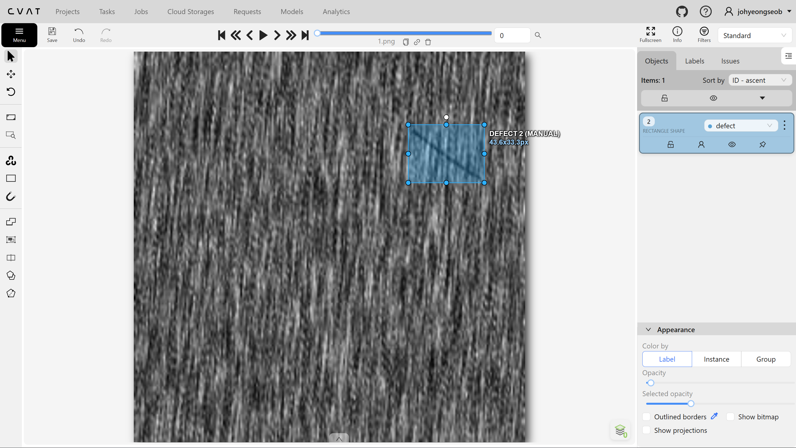
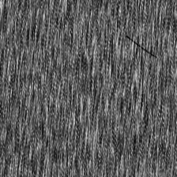
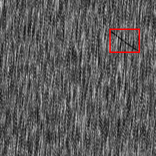

# DAGM Defect Annotation with CVAT

A small industrial defect annotation project created with CVAT Community and
exported in COCO format.



## CVAT Workflow

The annotation workflow consists of starting CVAT with Docker Compose, creating
a task with a `defect` rectangle label, uploading the images, drawing and
reviewing bounding boxes, and exporting the results in `COCO 1.0` format.

Step-by-step instructions are available in
[`docs/cvat_usage.md`](docs/cvat_usage.md).

## Overview

This project documents a manual bounding-box annotation workflow for defective
surface images from DAGM 2007 Class 2.

| Item | Value |
| --- | --- |
| Dataset | DAGM 2007 Class 2 |
| Images | 20 defective images |
| Label | `defect` |
| Shape | Rectangle |
| Annotation tool | CVAT Community v2.71.0 |
| Export format | COCO 1.0 |

## Annotation Summary

| Metric | Count |
| --- | ---: |
| Images | 20 |
| Bounding boxes | 20 |
| Categories | 1 |

The exported annotation file is available at
[`annotations/instances_default.json`](annotations/instances_default.json).

## Sample

| Original | COCO Bounding Box |
| --- | --- |
|  |  |

The red rectangle is rendered from the `[x, y, width, height]` coordinates in
the exported COCO annotation file.

The corresponding records in `annotations/instances_default.json` are:

```json
{
  "image": {
    "id": 1,
    "width": 224,
    "height": 224,
    "file_name": "1.png"
  },
  "annotation": {
    "id": 1,
    "image_id": 1,
    "category_id": 1,
    "area": 1453.9574000000002,
    "bbox": [157.01, 41.88, 43.61, 33.34],
    "iscrowd": 0
  },
  "category": {
    "id": 1,
    "name": "defect"
  }
}
```

## Annotation Policy

Each visible defect is enclosed by one tight and consistently applied bounding
box. Detailed annotation and review criteria are documented in
[`docs/annotation_guideline.md`](docs/annotation_guideline.md).

## Validation

Validate the COCO structure and bounding boxes with Python 3:

```bash
python scripts/validate_annotations.py
```

Expected summary:

```text
Images:      20
Annotations: 20
Categories:  1 (defect)
Validation:  OK
```

Regenerate the original and annotated sample images:

```bash
python -m pip install -r requirements.txt
python scripts/visualize_sample.py
```

## Repository Structure

```text
.
├── annotations/
│   └── instances_default.json
├── docs/
│   ├── annotation_guideline.md
│   └── cvat_usage.md
├── samples/
│   ├── annotated/
│   │   └── 1.png
│   ├── original/
│   │   └── 1.png
│   └── cvat_annotation.png
├── scripts/
│   ├── validate_annotations.py
│   └── visualize_sample.py
├── .gitignore
├── requirements.txt
└── README.md
```

## Dataset

[DAGM 2007](https://conferences.mpi-inf.mpg.de/dagm/2007/prizes.html)
is a synthetic dataset created for the Weakly Supervised Learning for
Industrial Optical Inspection competition. It contains textured surface images
with and without artificially generated defects.

### Copyright and Use

The official DAGM 2007 page does not provide a clear open-data license. This
repository includes only annotations and sample images, not the full dataset.

### Citation

```bibtex
@misc{dagm2007_industrial_inspection,
  author       = {{German Association for Pattern Recognition (DAGM)}},
  title        = {Weakly Supervised Learning for Industrial Optical Inspection},
  year         = {2007},
  howpublished = {DAGM 2007 Competition},
  url          = {https://conferences.mpi-inf.mpg.de/dagm/2007/prizes.html},
  note         = {Accessed: 2026-08-11}
}
```
